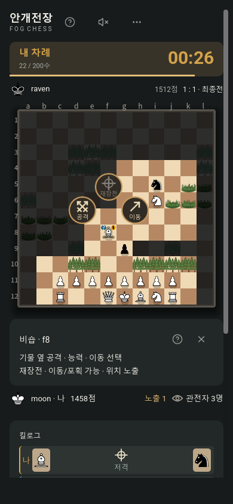
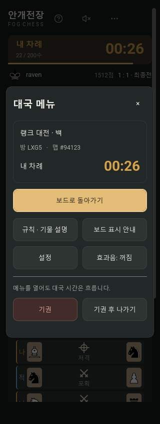
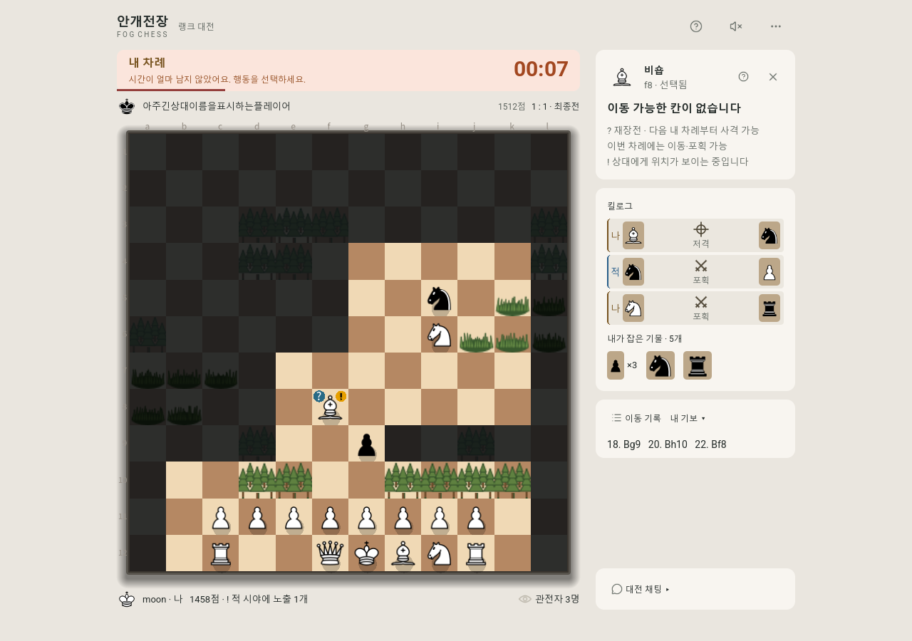
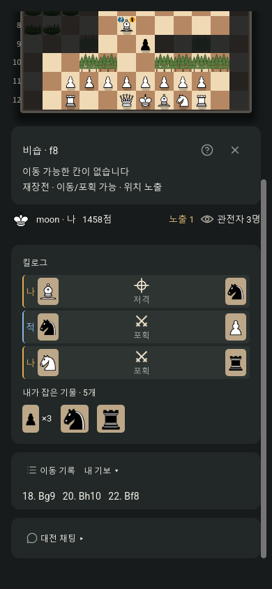

# Fogchess UI 개선 및 레퍼런스

2026-10-23 · 집 PC의 Godot 개발 소스에 적용

## 적용한 변경

1. **밝은 테마 킬로그**: 공격 방식 아이콘을 어두운 색으로 표시하고, `나·적`의 명암과 글자 크기를 개선했습니다. 검사 대상 아이콘과 식별 문구는 배경 대비 4.5:1 이상입니다.
2. **나가기 문구**: 실제로 기권 처리되는 상황은 `기권 후 나가기`, 관전은 `관전 나가기`, 종료된 대국·혼자 연습·안전한 대기 상태는 `나가기`로 표시합니다. 기존 확인창과 서버 처리 규칙은 유지합니다.
3. **모바일 행동 안내**: 보드 바로 아래의 일정한 높이 영역에 선택 기물·좌표, 다음 행동, 재장전·위치 노출을 표시합니다. 도움말에서 전체 설명을 확인할 수 있습니다. 상세 정보 영역의 내부 스크롤을 제거하여 페이지 스크롤 하나로 킬로그·기보·채팅까지 접근합니다.
4. **메뉴 타이머**: 대국 메뉴 안에 차례와 남은 시간을 표시합니다. 서버 상태 갱신을 따라가며, 시간이 부족하면 보드의 타이머와 같은 강조색을 사용합니다. 리플레이·종료 상태에서는 숨깁니다.
5. **작은 화면의 상태 표시**: 시간 경고를 짧게 표시하고, 전체 노출 기물 수를 플레이어 이름과 분리합니다. 선택 기물 좌표와 행동 설명 글자 크기도 조정했습니다.

모바일 안내는 보드 아래에 배치되며 페이지와 함께 스크롤됩니다. 별도의 화면 고정 오버레이는 아닙니다.

## 변경 후 화면

캡처는 현재 소스와 임시 서버의 테스트 대국을 렌더링한 것입니다. 임의로 생성되는 지형 배치는 이전 캡처와 다를 수 있습니다. 체스판·기물·지형 소스와 에셋은 바꾸지 않았습니다.

### 모바일 390px

### 모바일 대국 메뉴 320px

### 밝은 테마

### 모바일에서 기록까지 스크롤

## 다른 게임 레퍼런스

공식 안내와 공개 화면을 찾아보았습니다. 아래 적용 방향은 해당 자료를 바탕으로 한 이번 프로젝트의 설계 판단입니다. 다른 게임의 그래픽이나 에셋을 가져오지는 않았습니다.

| 레퍼런스 | 확인할 자료 | Fogchess에 참고한 방향 |
|---|---|---|
| Lichess | [공식 모바일 앱 소개와 스크린샷](https://lichess.org/@/lichess/blog/the-new-mobile-app/KXlgb3X2), [현재 앱 안내](https://lichess.org/app) | 작은 화면에서 보드를 중심으로 시간·플레이어 정보를 가까이 배치하는 구성 참고. 앱 소개의 스크린샷은 2024년 자료로, 현재 앱 모든 화면과 같다는 뜻은 아님. |
| chess.org | [공식 게임 화면·명령 설명](https://chess.org/?hl=en) | 보드, 시간·잡은 기물·기보·채팅 정보, 대국 명령을 구분하는 구조 참고. |
| MARVEL SNAP | [공식 화면 가이드](https://marvelsnap.helpshift.com/hc/en/3-marvel-snap/faq/654-new-to-marvel-snap/), [Retreat의 결과와 선택지](https://marvelsnap.helpshift.com/hc/en/3-marvel-snap/faq/29-what-does-retreating-do/) | 진행 행동과 포기 행동의 의미를 명확히 알리는 표현 참고. Fogchess에서는 실제 패배 처리와 버튼 문구를 연결. |

## 검증

- 대국 UI 렌더링·회귀 검사: **128개 통과**, `BOARD_FOCUS_FAILURES=0`.
- Godot 클라이언트와 임시 서버 통합 검사: **254개 통과**, `GODOT_SMOKE_FAILURES=0`.
- 320/390px 모바일, 1120/1366/1440/1920px 데스크톱 배치 확인.
- 열린 메뉴의 타이머 갱신, 종료·관전·연습 상태의 나가기 문구, 모바일 스크롤 접근, 선택 변경 시 보드 크기 유지 검사.
- 체스판·기물·지형·폰트 관련 보호 파일 **328개 SHA-256 일치**.
- 검사 로그: `ui-review-check.log`, `ui-integration-check.log`.

## 작업 위치와 적용 범위

- 개발 폴더: `바탕화면/Fogchess/fogchess`.
- 변경 전 원본: `바탕화면/Fogchess/backups/2026-10-23/before-ui-improvements`.
- 변경 파일: Godot UI 소스 6개, 기존 Godot 테스트 2개.
- Godot 편집기에서 게임을 다시 실행하면 수정한 UI를 확인할 수 있습니다.
- 이번 반영은 로컬 Godot 소스입니다. 기존 웹 빌드는 재생성하지 않았고 Fly.io 배포·Git 커밋·푸시는 하지 않았습니다.
